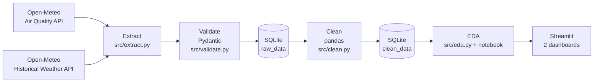
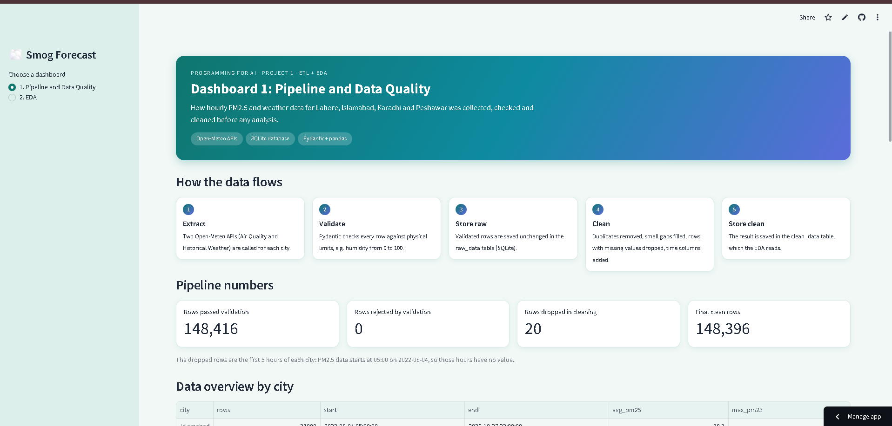
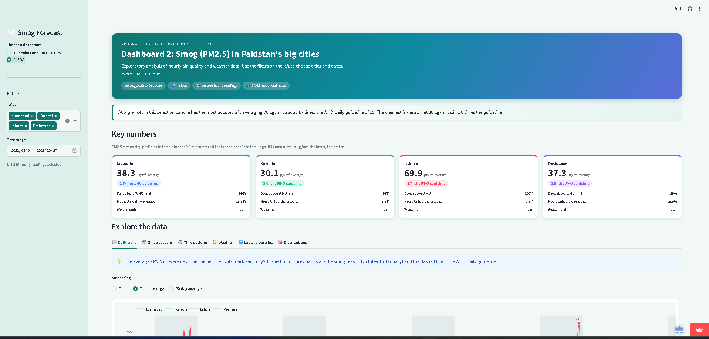

# Smog (PM2.5) Forecast: ETL and EDA Pipeline

Programming for AI, Project 1 (ETL + EDA). University of Engineering and Technology (UET) Lahore.

**Live dashboards:** https://smogproject-7cv9tpdwdtclu8uh4yl4de.streamlit.app/

## Problem

Smog is a serious health issue in Pakistani cities, especially in winter, but ground-sensor
coverage is limited. This project builds the data pipeline (ETL) and the exploratory analysis (EDA)
that a next-day PM2.5 forecasting model needs.

## Team

| Member | Responsibility |
|---|---|
| Tahreem Anees | Overall architecture and pipeline flow, Streamlit dashboards, GitHub and deployment. EDA: daily trend, smog seasons, weather relationships, autocorrelation and baseline (7 charts) |
| Sehrish Imran | EDA: time patterns (monthly, season, hourly, weekday), distributions, rows per year (7 charts) |
| Noor Fatima | Data extraction from the APIs and Pydantic validation |
| Fatima Khurram | Loading into SQLite and data cleaning |

## Pipeline



1. **Extract** (`src/extract.py`): call both APIs for each city and join the results by timestamp.
2. **Validate** (`src/validate.py`): a Pydantic model checks every row against physical limits
   (for example humidity 0 to 100, pressure 800 to 1100 hPa). Missing values are allowed here
   and handled in the cleaning step.
3. **Load raw** (`src/load.py`): store validated rows in SQLite (`raw_data`) and a run summary (`validation_log`).
4. **Clean** (`src/clean.py`): remove duplicates, fill gaps of up to 3 hours by interpolation,
   drop rows that still have missing values, add year, month, hour and season
   (`clean_data` and `cleaning_log` tables).
5. **EDA** (`src/eda.py`, `src/charts.py`, `notebooks/eda.ipynb`): six analysis parts, shown in the dashboard.

Details for each step: [Extract and validate](docs/extract_validate.md), [Load and clean](docs/load_clean.md), [Data dictionary](docs/data_dictionary.md).
## Data

- Cities: Lahore, Islamabad, Karachi, Peshawar
- Source: two free Open-Meteo APIs. Air Quality gives PM2.5. Historical Weather gives temperature,
  humidity, wind speed and surface pressure.
- Period: 2022-08-04 to 2026-10-27 (PM2.5 history starts on 2022-08-04), hourly
- Size: 148,416 rows validated, 148,396 clean rows (37,099 per city)

Pipeline numbers from the last run (`validation_log` and `cleaning_log` tables):

| Step | Result |
|---|---|
| Rows rejected by validation | 0 |
| Duplicate rows removed | 0 |
| Missing hours (gaps in time) | 0 |
| Rows dropped in cleaning | 20 (the first 5 hours of each city: PM2.5 starts at 05:00 on 2022-08-04) |

## Key findings

Average PM2.5 over the whole period, compared with the WHO 24-hour guideline of 15 µg/m³:

| City | Average PM2.5 (µg/m³) | Worst month |
|---|---|---|
| Lahore | 69.9 | January |
| Islamabad | 38.3 | January |
| Peshawar | 37.3 | January |
| Karachi | 30.1 | January |

- Lahore is the most polluted city. Its January average is about 140 µg/m³, against about 36 µg/m³ in April.
- Every city is worst in January and cleanest in spring, so season is a strong signal for forecasting.
- Weather and PM2.5 move together in winter, but correlation does not show cause and effect.

## Dashboards

Built with Streamlit. Use the sidebar to switch between the two dashboards.

1. **Pipeline and Data Quality:** how the data flows, pipeline numbers, per-city overview, data quality checks.
2. **EDA:** daily trend, smog seasons, hour of day and weekday patterns, weather correlations,
   autocorrelation with a "tomorrow = today" baseline, distributions. Filters: cities and date range.




## Project structure

```
Smog_Project/
├── app.py                 # Streamlit app (both dashboards)
├── requirements.txt
├── data/smog.db           # SQLite database (raw_data, clean_data and log tables)
├── src/
│   ├── extract.py         # call the two APIs
│   ├── validate.py        # Pydantic validation
│   ├── load.py            # extract + validate + save raw_data
│   ├── clean.py           # clean raw_data -> clean_data
│   ├── eda.py             # EDA functions and charts
│   ├── charts.py          # interactive Plotly charts for the dashboard
│   └── check_history.py   # helper: finds the first date with PM2.5 data
├── notebooks/eda.ipynb    # EDA notebook
├── figures/               # saved charts
└── docs/                  # dashboard screenshots
```

## How to run

```
pip install -r requirements.txt
streamlit run app.py
```

`data/smog.db` is included, so the dashboards run without calling the APIs.

To rebuild the database from scratch:

```
python src/load.py     # extract, validate, save raw_data (calls the APIs)
python src/clean.py    # build clean_data from raw_data
```

Note: `extract.py` always fetches up to 7 days before today, so a new run will give slightly
more rows than the numbers above.

## Limitations

- PM2.5 and weather values are modelled estimates from Open-Meteo (CAMS model), not ground-sensor readings.
  They can under- or over-estimate local extremes.
- Validation allows missing values; they are handled in the cleaning step.
- Correlation between weather and PM2.5 does not show cause and effect.

## Development note

The team used an AI assistant (Claude) while building the code and drafting the dashboard notes. Every member ran the pipeline,
reviewed the code of their own part, and is responsible for explaining it.